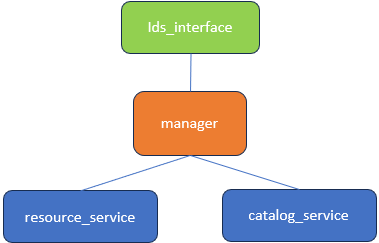

# IDS SDT Connector Pod Deployment Guide

## Overview
The IDS SDT Connector is a FastAPI-based service that interfaces with IDS Consumer of trueconnector to retrieve and serve resource data. This service acts as an abstraction layer for accessing IDS Consumer resources through a standardized API.

## Prerequisites
- Docker installed on your system
- Kubernetes cluster (K3s/K8s) running
- kubectl configured to access your cluster
- Python 3.11+ (for local development only)

## Quick Start

### 1. Clone/Copy the Files
Ensure you have all the required files in your project directory:
```
IDS_connector_SDT/
├── main.py
├── manager.py
├── catalog_service.py
├── resource_service.py
├── resource_state_store.py
├── ids_consumer_interface.py
├── requirements.txt
├── Dockerfile
├── .env
├── docker-compose.yaml
├── ids_connector_sdt_k8s_deployment.yml
├── build_and_deploy.sh
├── deploy.sh
├── quick_redeploy.sh
├── port_forward.sh
└── port_forward_remote.sh
```

### 2. IDS Connector Structure



### 3. Build and Deploy (First Time)
```bash
# Make scripts executable
sudo chmod +x build_and_deploy.sh deploy.sh quick_redeploy.sh port_forward.sh port_forward_remote.sh

# Build Docker image and deploy to Kubernetes
./build_and_deploy.sh
```

### 4. Subsequent Deployments
If the Docker image is already built:
```bash
./deploy.sh
```

### 5. Access the API
After deployment, start port forwarding to access the API:
```bash
# Local access only
./port_forward.sh

# OR for remote access (from other machines)
./port_forward_remote.sh
```

Then access:
- **API Documentation**: http://localhost:8004/docs
- **Alternative Docs**: http://localhost:8004/redoc
- **Health Check**: http://localhost:8004/health
- **Consumer Info**: http://localhost:8004/api/IDSconnector/SDT/info


## API Endpoints

### Main Endpoints
- `GET /api/IDSconnector/get_data_request` - Retrieve resource data
  - Query Parameters:
    - `toe_id`: Entity to be synchronized with (required)
    - `data_type`: Data format (json/csv) (required)
    - `data_path`: Resource path or "all" for all resources (required)
  
- `GET /api/IDSconnector/SDT/info` - Get consumer configuration info
- `POST /api/IDSconnector/clear-cache` - Clear resource cache
- `GET /health` - Health check endpoint

### Example API Calls
```bash
# Get all resources as JSON
curl "http://localhost:8004/api/IDSconnector/get_data_request?toe_id=test&data_type=json&data_path=all"

# Get specific resource
curl "http://localhost:8004/api/IDSconnector/get_data_request?toe_id=test&data_type=json&data_path=resource-name"

# Check health
curl http://localhost:8004/health

# Get consumer info
curl http://localhost:8004/api/IDSconnector/SDT/info
```

## Deployment Scripts

### build_and_deploy.sh
Builds Docker image and deploys to Kubernetes. Use for initial deployment or after code changes.

### deploy.sh
Deploys to Kubernetes using existing Docker image. Use for redeployment without rebuilding.

### quick_redeploy.sh
Quickly restarts the deployment with the same image. Useful for applying config changes.

### port_forward.sh
Sets up local port forwarding to access the API from localhost.

### port_forward_remote.sh
Sets up port forwarding on all interfaces for remote access.

## Troubleshooting

### Check Pod Status
```bash
kubectl get pods -l app=ids-connector-sdt
```

### View Logs
```bash
kubectl logs -f deployment/ids-connector-sdt
```

### Pod Not Starting (ImagePullBackOff)
If using K3s, import the Docker image:
```bash
docker save ids-consumer-api:latest | sudo k3s ctr images import -
```

### Clear and Restart
If you need to completely remove and redeploy:
```bash
# Delete all resources
kubectl delete -f ids_connector_sdt_k8s_deployment.yml

# Redeploy
./quick_redeploy.sh
```

## Local Development

### Using Docker Compose
For local development and testing:
```bash
# Start the service
docker-compose up -d

# View logs
docker-compose logs -f

# Stop the service
docker-compose down
```

### Running Directly with Python
```bash
# Create virtual environment
python -m venv venv
source venv/bin/activate  # On Windows: venv\Scripts\activate

# Install dependencies
pip install -r requirements.txt

# Run the application
python main.py
```

## Architecture

The IDS SDT Connector consists of:

1. **ConsumerCatalogService**: Handles catalog retrieval and caching
2. **ConsumerResourceService**: Manages resource fetching and caching
3. **IDS_ConsumerInterface**: FastAPI endpoint handlers
4. **ConsumerResourceManager**: Orchestrates all services
5. **ResourceStateStore**: Tracks per-resource sync state with PVC-backed persistence (see below)

The service communicates with the tc-consumer pod internally within the Kubernetes cluster and provides a RESTful API for external access.

## Resource State Store

`resource_state_store.py` was **not present in the original standalone deployment** (pre-September 2026). It was introduced when the connector was containerised and deployed as a k3s pod.

### Why it was added

The original `ids_consumer_interface.py` used a simple **in-memory, time-based cache**: a resource would be hidden from SDT once it had been handed out, then reappear automatically after a TTL regardless of whether SDT had actually ingested it. This was acceptable when the process ran continuously as a standalone application, but in a pod environment a restart would lose all cache state and re-offer every resource to SDT from scratch.

### What it does

`resource_state_store.py` replaces the time-based cache with a **state machine**:

```
AVAILABLE → DELIVERED → CONFIRMED  (terminal — resource never re-offered)
                      → AVAILABLE  (retry — SDT reported failure)
                      → DEAD       (terminal — max retry attempts reached)
```

State is persisted as JSON to `STATE_FILE` (default `/data/resource_sync_state.json`), which is backed by a PVC (`ids-connector-sdt-state-pvc`) so it survives pod restarts. If the file is unwritable, the store logs a warning and continues serving from memory rather than crashing.

A delivery timeout (`DELIVERY_TIMEOUT_SECONDS`) automatically reverts any resource stuck in DELIVERED back to AVAILABLE — this handles the case where the pod crashes between handing a resource to SDT and receiving the confirm callback.

### Dependency

`ids_consumer_interface.py` now imports from `resource_state_store`:
```python
from resource_state_store import resource_state, CONFIRMED, DEAD
```
The two files are coupled — removing `resource_state_store.py` without also reverting `ids_consumer_interface.py` to its original time-based cache version will break the service.

### Relevant endpoints

- `POST /api/IDSconnector/confirm` — SDT calls this after ingesting a resource to mark it CONFIRMED or report failure
- `POST /api/IDSconnector/clear-cache` — resets all state back to AVAILABLE, forcing a full re-sync on the next poll
- `GET /api/IDSconnector/SDT/info` — includes a `summary` field showing per-state resource counts

## Security Notes

- The service uses Basic Authentication to connect to tc-consumer
- SSL/TLS verification is disabled for internal cluster communication
- Credentials are stored in Kubernetes Secrets
- The pod runs as a non-root user (appuser) for security

## Performance

- Catalog listing is always fetched fresh from tc-consumer (no time-based cache)
- Resource sync state is tracked by `resource_state_store.py` — a resource is only re-offered to SDT if its delivery is explicitly confirmed as failed, not on a timer
- Use the `/api/IDSconnector/clear-cache` endpoint to reset all state and force a full re-sync

## Files extraction from IDS SDT connector

- Refer the file named unified_file_extractor.py
```bash
# To run the unified file extractor, execute
python3 unified_file_extractor.py sample_response.json
```
- Incorporate functionality of unified_file_extractor.py as a class in the SDT component
- Upon execution the file parses the reply from the IDS SDT and recreates the file that was sent to the IDS ToE.

## Support

For issues or questions:
1. Check pod logs: `kubectl logs -f deployment/ids-connector-sdt-deployment`
2. Ensure all required environment variables are set
3. Check network connectivity within the cluster