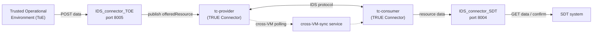

# IDS-Connector

Custom connector components that let the **SDT** system and a **Trusted Operational Environment (ToE)** exchange data through the [International Data Spaces (IDS)](https://internationaldataspaces.org/) ecosystem, built on top of the open-source, IDS-certified [TRUE Connector](true-connector/README.md).

---

## What's in this repo

| Component | Role | Docs |
|---|---|---|
| [`IDS_connector_SDT`](IDS_connector_SDT) | **Consumer-side** API (port 8004). Lets SDT pull resource data from the IDS ecosystem via TRUE Connector's `tc-consumer`, with stateful delivery tracking (`resource_state_store.py`) so nothing is lost on pod restart. | [Readme.md](IDS_connector_SDT/Readme.md) |
| [`IDS_connector_TOE`](IDS_connector_TOE) | **Provider-side** API (port 8005). Receives data pushed by a ToE and publishes it into the IDS ecosystem via TRUE Connector's `tc-provider`. | [Readme.md](IDS_connector_TOE/Readme.md) |
| [`cross-VM-sync`](cross-VM-sync) | Standalone polling service that keeps a provider and a consumer in sync when they run on separate VMs/nodes rather than the same cluster (NodePort access), with health/metrics endpoints. Deployed after `IDS_connector_SDT`. | [README.md](cross-VM-sync/README.md) |
| [`true-connector`](true-connector) | Vendored copy of the [TRUE Connector](https://github.com/Engineering-Research-and-Development) (Execution Core Container + BE Data App + UC Data App) — the IDS-certified connector that `IDS_connector_SDT` and `IDS_connector_TOE` sit in front of. Maintained upstream by Engineering (ENG), not by this project. | [README.md](true-connector/README.md) |

Root-level files:
- `IDSconnector_sdt.yml` / `IDSconnector_ToE.yml` — OpenAPI 3.0 specs for the SDT and ToE REST APIs.
- `purge_k8s_cluster.sh` — deletes all resources in a given Kubernetes namespace (used to reset a cluster during development).
- `Horizon-cobalt-logo.jpeg` — COBALT project branding (see funding note below).

## Architecture

- **ToE → `IDS_connector_TOE` → `tc-provider`**: a Trusted Operational Environment POSTs data to `IDS_connector_TOE`, which forwards it into TRUE Connector's provider (`tc-provider`) as an offered IDS resource.
- **`tc-provider` ↔ `tc-consumer`**: data exchange between provider and consumer happens over the standard IDS protocol, handled entirely by TRUE Connector.
- **`tc-consumer` → `IDS_connector_SDT` → SDT**: `IDS_connector_SDT` queries `tc-consumer` and exposes a simplified REST API that SDT uses to pull resources and confirm delivery (`AVAILABLE → DELIVERED → CONFIRMED/DEAD`).
- **`cross-VM-sync`**: an alternate path used when the provider and consumer run on separate VMs/nodes instead of the same cluster — it polls the provider directly and relays to the consumer.

Both `IDS_connector_SDT` and `IDS_connector_TOE` are deployed as independent Kubernetes/K3s pods, each with its own Dockerfile, ConfigMap/Secret, and build/deploy scripts — see their individual READMEs for full deployment instructions, API reference, and troubleshooting.

## Getting started

Each component is deployed independently. Start with whichever side you need:
- Consumer/SDT side → [`IDS_connector_SDT/Readme.md`](IDS_connector_SDT/Readme.md)
- Provider/ToE side → [`IDS_connector_TOE/Readme.md`](IDS_connector_TOE/Readme.md)
- Underlying TRUE Connector (ECC / BE Data App / UC Data App) → [`true-connector/README.md`](true-connector/README.md)

---

## Authorship

Created and maintained by CTTC (https://www.cttc.cat/).

---

## License

This project is licensed under the **Apache License 2.0**. See the [LICENSE](LICENSE) file for
the full license text.

---

  

  This project has received funding from the European Union’s Horizon Europe research and innovation programme under Grant Agreement No. 101119602.

  

